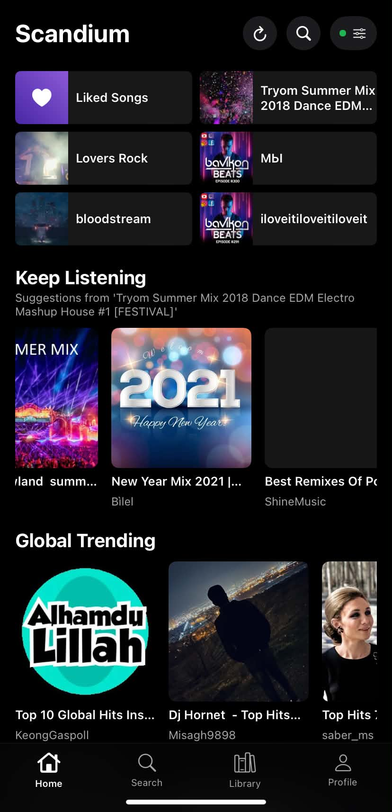
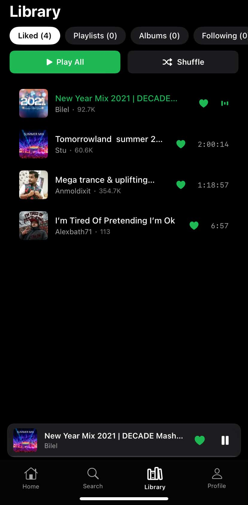
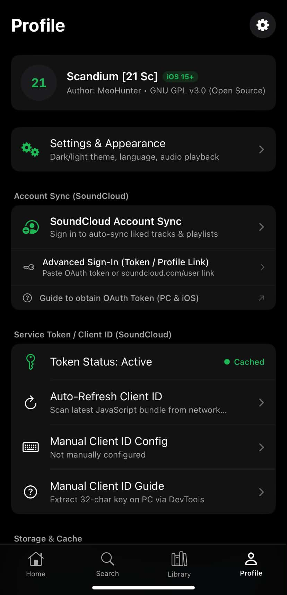

# Scandium

 

Native SoundCloud client for legacy and modern iOS.

Install via TrollStore or sideloading, open it, and stream directly without ads or web wrappers. Scandium is built from scratch in SwiftUI for iOS 15.0 and later:

- **Native Audio Engine.** Streams progressive MP3 (128kbps) and HLS AAC (256kbps) directly through `AVFoundation`. Supports background playback, Lock Screen and Control Center integration (`MPNowPlayingInfoCenter`, `MPRemoteCommandCenter`), variable playback speeds (`0.8x` to `2.0x`), and continuous autoplay queues.
- **Dynamic Client ID Extraction.** Automatically scrapes and caches valid 32-character SoundCloud v2 `client_id` tokens from public web bundles with multi-tier fallbacks and manual override support—no hardcoded credentials required.
- **Account Sync & Local Library.** Sign in via Web OAuth, token, or profile URL to sync your liked tracks, playlists, albums, and followed artists, backed by a two-tier memory and disk cache for instant startup.
- **Linux Cross-Compilation.** Designed to compile without macOS or Xcode using `xtool` and the Darwin Swift SDK, complete with automated Mach-O weak-link patching (`SwiftUICore`) for backward compatibility down to iOS 15.

## Screenshots

|  |  |  |  |
| :---: | :---: | :---: | :---: |
| Home & Discovery | Now Playing | Library | Settings |

## Installation

1. Download the latest `Scandium.ipa` from [Releases](https://github.com/MeoHunterr/Scandium/releases).
2. Install using **TrollStore** (recommended for unsandboxed persistence) or sideload via Sideloadly / AltStore.

## Building from Source

Requires **Swift 6.4+** and **[xtool](https://xtool.sh)** configured with the iOS Darwin SDK on Linux or macOS:

    git clone https://github.com/MeoHunterr/Scandium.git
    cd Scandium
    python3 scripts/prebuild_audit.py
    ./scripts/build_ipa.sh

The packaged `Scandium.ipa` will be generated in the project root.

## Disclaimer

Scandium is an independent open-source project developed for educational and personal use to support legacy iOS devices. It is not affiliated with, endorsed by, or connected to SoundCloud.

## License

Licensed under the [GPL-3.0 License](LICENSE).