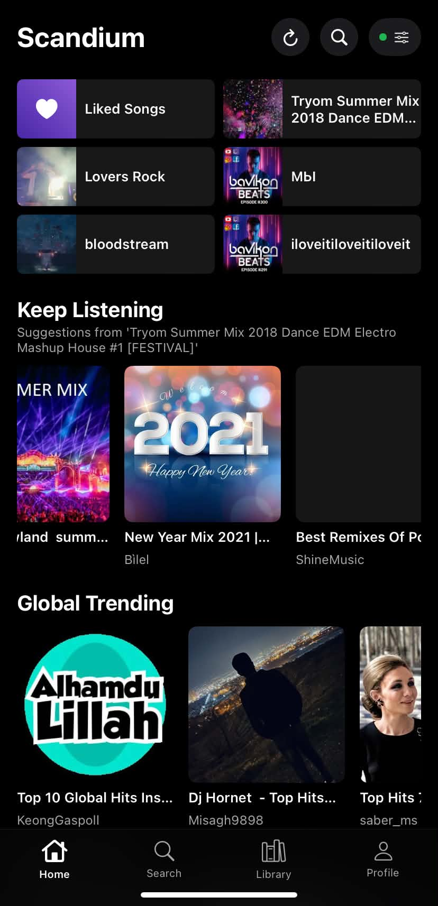
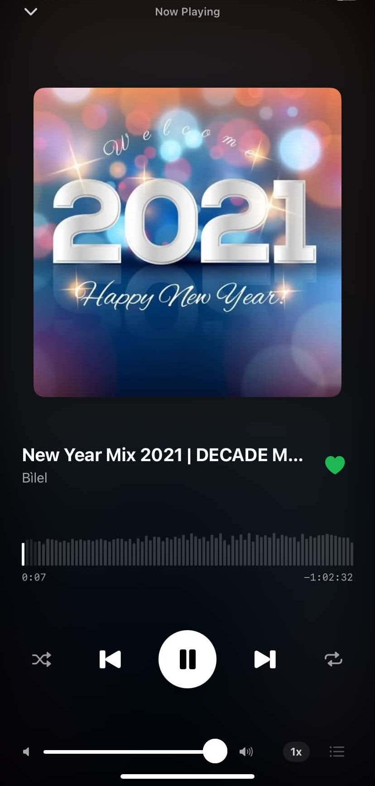
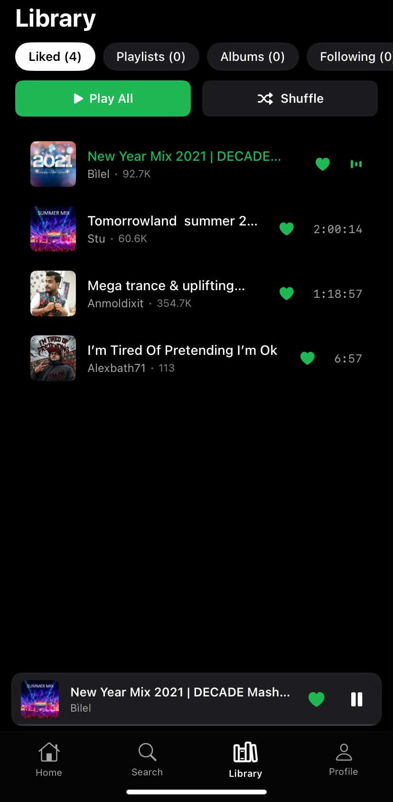
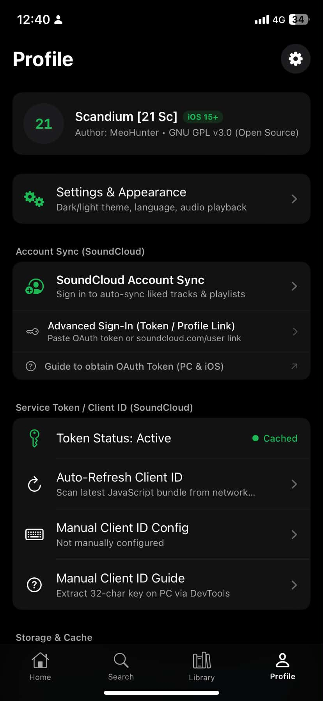

<meta name="google-site-verification" content="g_vctH-gmexU5uED5zusBBbLfsFcWf1QmGBe_U6ClXk" />
# Scandium

 

Native SoundCloud client for legacy and modern iOS.

Install via TrollStore or sideloading, open it, and stream directly without ads or web wrappers. Scandium is built from scratch in SwiftUI for iOS 15.0 and later:

- **Native Audio Engine.** Streams progressive MP3 (128kbps) and HLS AAC (256kbps) directly through `AVFoundation`. Supports background playback, Lock Screen and Control Center integration (`MPNowPlayingInfoCenter`, `MPRemoteCommandCenter`), variable playback speeds (`0.8x` to `2.0x`), and continuous autoplay queues.
- **Dynamic Client ID Extraction.** Automatically scrapes valid 32-character SoundCloud v2 `client_id` tokens from public JavaScript bundles with parallel extraction and manual override support—zero hardcoded credentials (100% FOSS compliant).
- **SQLite3 Local Library & Account Sync.** Sign in via Web OAuth, token, or profile URL to sync your liked tracks, playlists, albums, and followed artists, backed by native C `SQLite3` persistence and automatic 250MB LRU disk cache eviction.
- **GPU-Accelerated Ambient Artwork.** Background glow pre-rendered on background threads via `CoreImage` downsampling and `CIGaussianBlur`, sustaining smooth 60 FPS on legacy A9–A11 chips without SwiftUI live view blur.
- **Linux Cross-Compilation.** Designed to compile without macOS or Xcode using `xtool` and the Darwin Swift SDK, complete with automated Mach-O weak-link patching (`SwiftUICore`) for backward compatibility down to iOS 15.

## Screenshots

|  |  |  |  |
| :---: | :---: | :---: | :---: |
| Home & Discovery | Now Playing | Library | Settings |

## Installation

1. Download the latest `Scandium.ipa` from [Releases](https://github.com/MeoHunterr/Scandium/releases).
2. Install using **TrollStore** (recommended for unsandboxed persistence) or sideload via Sideloadly / AltStore.

## Building from Source

Requires **Swift 6.4+** and **[xtool](https://xtool.sh)** configured with the iOS Darwin SDK on Linux or macOS:

    git clone https://github.com/MeoHunterr/Scandium.git
    cd Scandium
    python3 scripts/prebuild_audit.py
    ./scripts/build_ipa.sh

`build_ipa.sh` requires `ldid` in `PATH` to pseudo-sign the bundle with `entitlements.plist` for TrollStore. If `ldid` is not installed and you want to compile an unsigned `.ipa` for local testing or external signing:

    ./scripts/build_ipa.sh --allow-unsigned
    # or: ALLOW_UNSIGNED=1 ./scripts/build_ipa.sh

The packaged `Scandium.ipa` will be generated in the project root.

## Disclaimer

Scandium is an independent open-source project developed for educational and personal use to support legacy iOS devices. It is not affiliated with, endorsed by, or connected to SoundCloud.

## License

Licensed under the [GPL-3.0 License](LICENSE).
