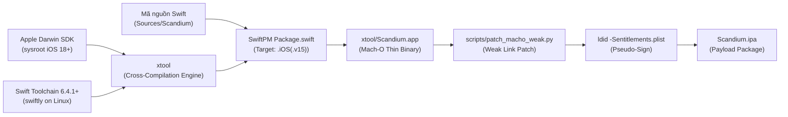
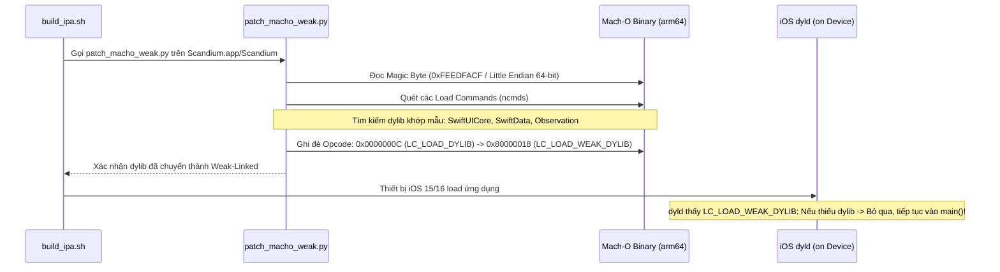
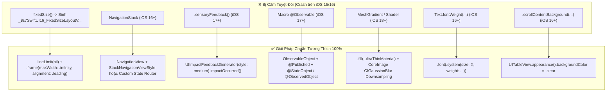
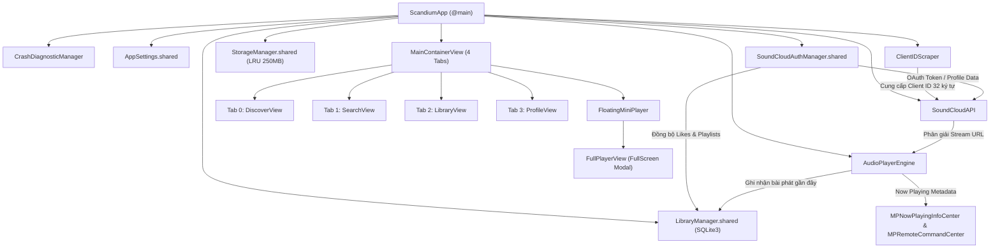
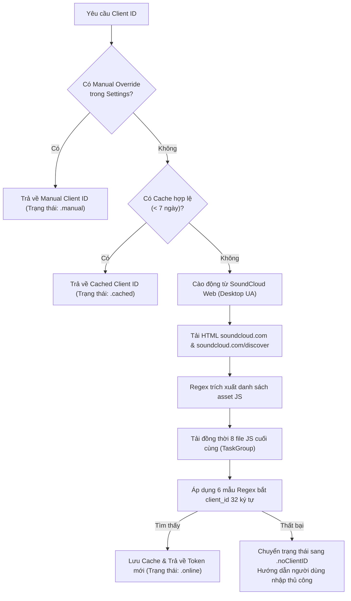
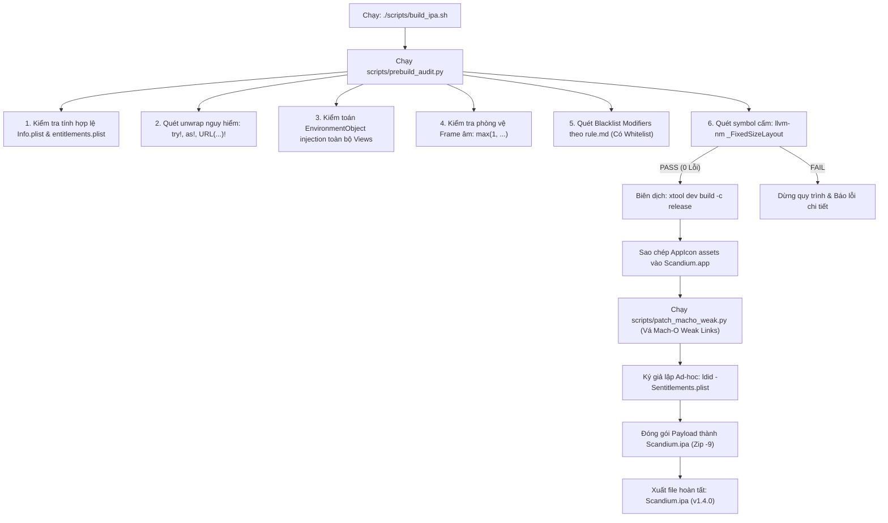

# BÁO CÁO TỔNG QUAN KỸ THUẬT DỰ ÁN SCANDIUM (21 Sc)
**Tài liệu Kiến trúc Kỹ thuật, Cơ chế Tương thích Ngược & Quy trình Biên dịch**  
**Tác giả:** MeoHunter  
**Phiên bản hiện tại:** 1.4.0 | **Giấy phép:** GNU General Public License v3.0 (GPL-3.0)  
**Mục tiêu nền tảng:** iOS 15.0+ (iOS 15.0 – iOS 18.x) | **Môi trường build:** Linux Cross-Compilation via `xtool`

---

## MỤC LỤC
1. [Giới thiệu Tổng quan & Sứ mệnh Dự án](#1-giới-thiệu-tổng-quan--sứ-mệnh-dự-án)
2. [Ngăn xếp Công nghệ & Kiến trúc Biên dịch trên Linux](#2-ngăn-xếp-công-nghệ--kiến-trúc-biên-dịch-trên-linux)
3. [Cơ chế Tương thích Ngược Mach-O & Kỹ thuật Vá Nhị phân](#3-cơ-chế-tương-thích-ngược-mach-o--kỹ-thuật-vá-nhị-phân)
4. [Bộ Quy tắc Lập trình SwiftUI An toàn cho iOS 15.0+](#4-bộ-quy-tắc-lập-trình-swiftui-an-toàn-cho-ios-150)
5. [Kiến trúc Chi tiết các Module Cốt lõi (Core Engine)](#5-kiến-trúc-chi-tiết-các-module-cốt-lõi-core-engine)
   - [5.1. ScandiumApp & Quy trình Khởi chạy An toàn (Staged Launch)](#51-scandiumapp--quy-trình-khởi-chạy-an-toàn-staged-launch)
   - [5.2. CrashDiagnosticManager — Bẫy Lỗi Fatal C-Signal Chuẩn Async-Signal-Safe](#52-crashdiagnosticmanager--bẫy-lỗi-fatal-c-signal-chuẩn-async-signal-safe)
   - [5.3. ClientIDScraper — Cơ chế Cào Client ID Động & FOSS Tuyệt Đối](#53-clientidscraper--cơ-chế-cào-client-id-động--foss-tuyệt-đối)
   - [5.4. SoundCloudAPI — Tầng Mạng API v2 & Phân giải Luồng Stream](#54-soundcloudapi--tầng-mạng-api-v2--phân-giải-luồng-stream)
   - [5.5. AudioPlayerEngine — Động cơ Phát nhạc Nền & Tích hợp Hệ thống](#55-audioplayerengine--động-cơ-phát-nhạc-nền--tích-hợp-hệ-thống)
   - [5.6. SoundCloudAuthManager & KeychainHelper — Quản lý Danh tính & Bảo mật](#56-soundcloudauthmanager--keychainhelper--quản-lý-danh-tính--bảo-mật)
   - [5.7. LibraryManager — Cơ sở Dữ liệu Bản địa SQLite3 & Migration](#57-librarymanager--cơ-sở-dữ-liệu-bản-địa-sqlite3--migration)
   - [5.8. StorageManager — Thống kê & Cơ chế Dọn dẹp Bộ nhớ Đệm LRU Tự động](#58-storagemanager--thống-kê--cơ-chế-dọn-dẹp-bộ-nhớ-đệm-lru-tự-động)
   - [5.9. AppSettings — Hệ thống Tùy biến & Quản lý Alternate Icon](#59-appsettings--hệ-thống-tùy-biến--quản-lý-alternate-icon)
6. [Hệ thống Thiết kế Giao diện & Tối ưu GPU CoreImage](#6-hệ-thống-thiết-kế-giao-diện--tối-ưu-gpu-coreimage)
7. [Quy trình Đóng gói Tự động hoá & Kiểm toán Tiền Biên dịch (Auditing)](#7-quy-trình-đóng-gói-tự-động-hoá--kiểm-toán-tiền-biên-dịch-auditing)
8. [Cấu trúc Cây Thư mục Dự án](#8-cấu-trúc-cây-thư-mục-dự-án)
9. [Tuân thủ Pháp lý & Giới hạn Bản quyền FOSS](#9-tuân-thủ-pháp-lý--giới-hạn-bản-quyền-foss)

---

## 1. Giới thiệu Tổng quan & Sứ mệnh Dự án

**Scandium** (ký hiệu hóa học `[21 Sc]`) là ứng dụng nghe nhạc SoundCloud nguyên bản (Native iOS Client), mã nguồn mở, độc lập và siêu nhẹ, được viết 100% bằng **Swift** và **SwiftUI**.

### Bối cảnh & Sứ mệnh
Ứng dụng SoundCloud chính thức đã ngừng hỗ trợ các phiên bản hệ điều hành cũ (iOS 15 và iOS 16), biến hàng triệu thiết bị phần cứng vẫn còn hoạt động tốt (như iPhone 6s/6s Plus, iPhone 7/7 Plus, iPhone SE Gen 1, iPhone 8/8 Plus, iPhone X và các dòng iPad thế hệ cũ) thành những thiết bị không thể nghe nhạc SoundCloud một cách mượt mà nếu không dùng trình duyệt web nặng nề.

Scandium được thiết kế nhằm giải quyết triệt để vấn đề này:
- **Tương thích tuyệt đối xuống tới iOS 15.0:** Hoạt động ổn định trên cả thiết bị legacy (chip Apple A9–A11) và các thiết bị hiện đại chạy iOS 17/18+.
- **Pure Native Audio Streaming:** Sử dụng trực tiếp `AVFoundation` và `AVPlayer`, không nhúng Web Wrapper, không dùng WebView để phát nhạc, tiết kiệm tối đa RAM và thời lượng pin.
- **Không quảng cáo & Không gián đoạn:** Truyền phát trực tiếp từ các CDN máy chủ của SoundCloud (`cf-media.sndcdn.com`).
- **Phân phối linh hoạt & An toàn Sideload:** Tương thích với cả **TrollStore** (chạy không sandbox) lẫn các công cụ sideload tiêu chuẩn (**AltStore**, **Sideloadly**) mà không gặp lỗi phân quyền hay xung đột sandbox.

---

## 2. Ngăn xếp Công nghệ & Kiến trúc Biên dịch trên Linux

Dự án Scandium sở hữu kiến trúc đặc biệt: **biên dịch mã nguồn iOS ngay trên môi trường Linux (Ubuntu/Debian/Arch) mà không cần máy Mac hay Xcode IDE**.



### Chi tiết các thành phần ngăn xếp:
1. **Build Toolchain:** 
   - `xtool`: Công cụ thay thế Xcode chạy trên Linux, quản lý quy trình gọi SwiftPM kết hợp với các cờ cross-compile trỏ tới Darwin SDK.
   - `swiftly`: Trình quản lý phiên bản Swift toolchain trên Linux (`Swift 6.4.1+`).
   - `Darwin SDK`: Bộ SDK trích xuất từ Xcode (chứa C/Objective-C/Swift headers, `.tbd` stub libraries và metadata cho kiến trúc `arm64-apple-ios`).
2. **Cấu hình dự án thuần Declarative:**
   - Hoàn toàn **KHÔNG** dùng `.xcodeproj` hay `.xcworkspace`.
   - Hoàn toàn **KHÔNG** dùng Storyboards, `.xib`, hay `.nib`.
   - Cấu hình gói thông qua `Package.swift` với `swift-tools-version: 5.9` và `platforms: [.iOS(.v15)]`.
   - Cấu hình đóng gói qua `xtool.yml`:
     ```yaml
     version: 1
     bundleID: com.meohunter.scandium
     product: Scandium
     infoPath: Info.plist
     ```
3. **Phân quyền Bảo mật Sideload & TrollStore (`entitlements.plist`):**
   ```xml
   <?xml version="1.0" encoding="UTF-8"?>
   <!DOCTYPE plist PUBLIC "-//Apple//DTD PLIST 1.0//EN"
     "http://www.apple.com/DTDs/PropertyList-1.0.dtd">
   <plist version="1.0">
   <dict>
       <key>application-identifier</key>
       <string>com.meohunter.scandium</string>
       <key>com.apple.private.security.no-sandbox</key>
       <true/>
   </dict>
   </plist>
   ```
   > [!IMPORTANT]
   > Trong phiên bản 1.4.0, khóa `platform-application` đã được loại bỏ hoàn toàn. Điều này giúp loại bỏ xung đột quyền bảo mật khi sideload qua AltStore/Sideloadly, trong khi vẫn giữ `com.apple.private.security.no-sandbox = true` để hỗ trợ tối ưu trên TrollStore. Mọi đường dẫn dữ liệu của app đều nằm gọn trong container chuẩn (`Documents`, `Caches`, `NSTemporaryDirectory()`).

---

## 3. Cơ chế Tương thích Ngược Mach-O & Kỹ thuật Vá Nhị phân

### Vấn đề cốt lõi (The Root Cause)
Khi biên dịch mã nguồn SwiftUI trên Linux bằng bộ công cụ **Swift 6.x** cùng **Darwin SDK iOS 18+**, trình liên kết (`ld64` / `lld`) sẽ tự động chèn các Load Command bắt buộc (`LC_LOAD_DYLIB` - opcode `0x0C`) vào Mach-O binary cho các framework mới như `SwiftUICore.framework`, `SwiftData.framework`, `Observation.framework`.

Tuy nhiên, trên thiết bị chạy **iOS 15 hoặc iOS 16**, các dynamic library này chưa hề tồn tại trong dyld shared cache. Khi người dùng mở ứng dụng, dynamic linker của iOS (`dyld`) lập tức hủy tiến trình với lỗi:
```text
dyld: Library not loaded: /System/Library/Frameworks/SwiftUICore.framework/SwiftUICore
Referenced from: /var/containers/Bundle/Application/.../Scandium.app/Scandium
Reason: image not found -> SIGABRT
```

### Giải pháp kỹ thuật: Vá Mach-O Load Command (`patch_macho_weak.py`)
Dự án Scandium tự động hóa việc vá cấu trúc nhị phân Mach-O trực tiếp ở mức byte:



### Bảng tra cứu Load Command trong Mach-O:
| Hằng số | Giá trị Hex | Ý nghĩa với dyld |
|---|---|---|
| `LC_LOAD_DYLIB` | `0x0000000C` | Bắt buộc phải có thư viện. Thiếu sẽ làm sập app ngay lập tức (`SIGABRT`). |
| `LC_LOAD_WEAK_DYLIB` | `0x80000018` | Liên kết yếu (`0x18 \| LC_REQ_DYLD`). Nếu thiếu thư viện trên hệ điều hành cũ, `dyld` bỏ qua và tiếp tục nạp nhị phân bình thường. |

---

## 4. Bộ Quy tắc Lập trình SwiftUI An toàn cho iOS 15.0+

Nhằm đảm bảo nhị phân sinh ra không chứa các Symbol metadata hoặc Witness Tables chỉ có trên iOS 17/18, Scandium thực thi nghiêm ngặt bộ quy tắc kiểm soát mã nguồn theo `rule.md`:



### Nguyên tắc phòng vệ Frame âm trong `GeometryReader`
Khi một view được khởi tạo trong SwiftUI, kích thước ban đầu do `GeometryReader` báo về có thể bằng 0. Nếu thực hiện phép trừ trực tiếp (`geometry.size.width - 48`), layout engine sẽ nhận giá trị âm (`-48`), gây ra layout breakdown hoặc crash `SIGABRT` trên iOS 15:
```swift
// ❌ SAI: Gây crash nếu width = 0 lúc mount view
let artSize = min(geometry.size.width - 48, geometry.size.height * 0.40)

// ✅ ĐÚNG (Quy tắc Scandium): Luôn phòng vệ bằng max(1, ...)
let screenWidth = max(1, geometry.size.width)
let screenHeight = max(1, geometry.size.height)
let artSize = max(1, min(screenWidth - 48, screenHeight * 0.38))
```

---

## 5. Kiến trúc Chi tiết các Module Cốt lõi (Core Engine)

Dự án tuân theo mô hình **Unidirectional Data Flow** kết hợp **Observable State Machine**:



---

### 5.1. ScandiumApp & Quy trình Khởi chạy An toàn (Staged Launch)
File: [`Sources/Scandium/ScandiumApp.swift`](file:///home/meohunter/Documents/Scandium/Sources/Scandium/ScandiumApp.swift)

Điểm vào `@main` không tải ồ ạt toàn bộ cây giao diện ngay lập tức nhằm tránh xung đột tài nguyên giữa `UIWindowScene` và hệ thống âm thanh `AVFoundation`:
1. **Pha 0 (Cài đặt chẩn đoán):** Ngay trong `init()`, gọi `CrashDiagnosticManager.shared.install()` để mở sẵn file descriptor bắt lỗi và bảo toàn log crash cũ.
2. **Pha 1 (Kiểm tra Safe Mode):** Trong sự kiện `.onAppear` của `WindowGroup`, kiểm tra cờ `didCrashDuringLastLaunch`. Nếu phiên trước đó bị crash, ứng dụng sẽ dựng `SafeModeView` hiển thị đầy đủ callstack.
3. **Pha 2 (Mount UI chính thức & Kích hoạt LRU):** Nếu không có sự cố, kích hoạt `isUIReady = true` qua hiệu ứng mờ dần (opacity transition), bơm toàn bộ các `@EnvironmentObject` (`scraper`, `api`, `player`, `library`) xuống cây giao diện, đồng thời chạy nền `StorageManager.shared.evictAudioTempIfNeeded()` để dọn dẹp các tệp âm thanh tạm cũ.

---

### 5.2. CrashDiagnosticManager — Bẫy Lỗi Fatal C-Signal Chuẩn Async-Signal-Safe
File: [`Sources/Scandium/Core/CrashDiagnosticManager.swift`](file:///home/meohunter/Documents/Scandium/Core/CrashDiagnosticManager.swift)

Trên môi trường iOS không kết nối Xcode debugger, khi xảy ra lỗi cấp thấp (con trỏ null, heap hư hỏng, tràn bộ nhớ), tiến trình sẽ bị hạt nhân hủy tức khắc. Việc gọi các hàm cấp phát bộ nhớ heap như `Thread.callStackSymbols` hay Swift `String` bên trong C-signal handler sẽ gây deadlock hoặc crash lặp:

#### Cải tiến cốt lõi trong v1.4.0:
1. **Mở sẵn File Descriptor (Safe Context):** Trong `install()`, mở sẵn file descriptor thông qua `Darwin.open(path, O_WRONLY | O_CREAT | O_TRUNC, 0o644)` trỏ vào `Documents/last_crash.txt`.
2. **Bảo tồn Crash Log cũ:** Nếu phát hiện `last_crash.txt` từ phiên trước có dung lượng `> 0`, hệ thống tự động đọc và cache vào `previousCrashLog` đồng thời sao chép sang `Documents/previous_crash.txt` trước khi reset file descriptor mới, đảm bảo `SafeModeView` luôn đọc được đúng nguyên nhân sự cố.
3. **100% Async-Signal-Safe Handlers:** Signal handler (`@convention(c)`) cho `SIGABRT`, `SIGILL`, `SIGSEGV`, `SIGBUS`, `SIGFPE`, `SIGPIPE`, `SIGTRAP` **CHỈ** sử dụng các lời gọi hệ thống an toàn:
   - `Darwin.write()` để ghi header thông báo.
   - `backtrace(&frames, 64)` để lấy địa chỉ các frame trên call stack.
   - `backtrace_symbols_fd(&frames, count, crashLogFD)` để xả thẳng danh sách symbol ra file descriptor mà không cấp phát bất kỳ byte nào trên heap.
   - `Darwin.fsync(crashLogFD)` để flush dữ liệu xuống đĩa trước khi re-raise tín hiệu mặc định.
4. **Ngoại lệ Cấp cao:** `NSSetUncaughtExceptionHandler` vẫn được duy trì độc lập để xử lý các ngoại lệ `NSException` của Objective-C / Cocoa.

---

### 5.3. ClientIDScraper — Cơ chế Cào Client ID Động & FOSS Tuyệt Đối
File: [`Sources/Scandium/Core/ClientIDScraper.swift`](file:///home/meohunter/Documents/Scandium/Core/ClientIDScraper.swift)

SoundCloud API v2 yêu cầu tham số `client_id` (chuỗi 32 ký tự hex/alphanumeric) trong mọi request. Để tuân thủ cam kết FOSS và tránh bị SoundCloud chặn đồng loạt:
- **Xóa bỏ 100% Fallback ID Hardcode:** Phiên bản 1.4.0 đã gỡ bỏ hoàn toàn danh sách Client ID tĩnh trong mã nguồn.
- **Quét Động Mở Rộng 8 Bundle Cuối:** Khi cào động từ trang chủ hoặc `/discover`, hệ thống phân tích HTML, trích xuất tất cả các tệp JavaScript bundle trên CDN (`https://a-v2.sndcdn.com/assets/*.js`) và tải đồng thời **8 tệp JS cuối cùng** (`suffix(8)` trong reverse order).
- **Hủy Tác Vụ Sớm (Early Termination):** Quá trình quét chạy trên `withThrowingTaskGroup`. Ngay khi bất kỳ tệp JS nào trích xuất thành công Client ID hợp lệ qua regex, nhóm tác vụ lập tức gọi `group.cancelAll()` và trả về kết quả, tiết kiệm băng thông và tăng tốc độ kết nối.
- **Trạng thái `.noClientID`:** Nếu cả cào động và cache đều không khả dụng, hệ thống chuyển sang trạng thái `.noClientID` để giao diện hiển thị hướng dẫn người dùng nhập Manual Client ID trong Cài đặt.



---

### 5.4. SoundCloudAPI — Tầng Mạng API v2 & Phân giải Luồng Stream
File: [`Sources/Scandium/Core/SoundCloudAPI.swift`](file:///home/meohunter/Documents/Scandium/Core/SoundCloudAPI.swift)

Endpoint cơ sở: `https://api-v2.soundcloud.com`. Lớp mạng này chịu trách nhiệm:

1. **Tự Động Hồi Phục Khi Hết Hạn Token (Automatic Retry on 401/403):**  
   Mọi request gửi qua hàm `performRawRequest` đều theo dõi mã phản hồi HTTP. Nếu máy chủ SoundCloud trả về `401 Unauthorized` hoặc `403 Forbidden`, hệ thống sẽ kích hoạt `scraper.refreshClientID()`, lấy ID mới, cập nhật tham số URL và tự động retry (tối đa 2 lần) một cách hoàn toàn trong suốt với người dùng.

2. **Chiến lược Phân Giải Luồng Phát (`resolveStreamURL`):**
   Mỗi bài hát trên SoundCloud có danh sách định dạng mã hóa (`track.media.transcodings`). Scandium áp dụng hệ thống tính điểm ưu tiên (`transcodingPriority`):
   - **Progressive MP3 (Direct MP3 Stream):** +100 điểm. Trực tiếp giải mã dòng stream byte MP3 128kbps. Đây là giao thức tối ưu nhất cho chip xử lý cũ của iPhone 6s/7/8 vì tiêu hao CPU rất thấp.
   - **HLS (.m3u8 index):** +50 điểm. Giao thức phân đoạn HTTP Live Streaming.
   - **MIME Type MPEG (`audio/mpeg`):** +20 điểm.
   - **Chất lượng HQ (`hq`):** +5 điểm.
   
   Sau khi chọn được transcoding tốt nhất, gửi GET request đến endpoint transcoding đó để nhận URL CDN cuối cùng (`https://cf-media.sndcdn.com/...`).

3. **Nâng cấp Ảnh bìa Độ phân giải cao (High-Res Artwork Helper):**
   Mặc định API trả về ảnh thumbnail nhỏ (`-large.jpg`, khoảng 100x100). Scandium tự động chuyển đổi chuỗi định dạng URL sang `-t500x500.jpg` cho mọi ảnh hiển thị trong Player và Khám phá.

4. **Trích xuất Dữ liệu Sóng âm (Waveform JSON Samples):**
   URL waveform mặc định trả về ảnh PNG (`https://wave.sndcdn.com/xxx_m.png`). API helper sẽ chuyển hướng sang định dạng JSON (`/w/json/`), giải mã thành mảng `samples: [Float]` để hiển thị thanh scrubber tương tác.

---

### 5.5. AudioPlayerEngine — Động cơ Phát nhạc Nền & Tích hợp Hệ thống
File: [`Sources/Scandium/Core/AudioPlayerEngine.swift`](file:///home/meohunter/Documents/Scandium/Core/AudioPlayerEngine.swift)

Lớp quản lý âm thanh cốt lõi duy trì một thể hiện `AVPlayer` duy nhất xuyên suốt vòng đời ứng dụng.

#### Các đặc tính kỹ thuật nổi bật:
- **Khởi tạo trễ (Lazy Setup - `setupIfNeeded`):** Trì hoãn việc kích hoạt `AVAudioSession` cho đến lần đầu tiên phát nhạc để tránh xung đột với khởi tạo cửa sổ trên iOS 15.
- **Tích hợp Trung tâm Điều khiển & Màn hình khóa:**
  - `MPNowPlayingInfoCenter`: Đồng bộ tiêu đề bài hát, tên nghệ sĩ, album, tổng thời lượng, vị trí phát hiện tại và ảnh bìa chất lượng cao (`MPMediaItemArtwork`).
  - `MPRemoteCommandCenter`: Lắng nghe các lệnh phần cứng (nút tai nghe, thanh điều khiển Lock Screen, Apple Watch): `play`, `pause`, `togglePlayPause`, `nextTrack`, `previousTrack`, `changePlaybackPosition` (seek).
- **Tự động ngắt khi rút tai nghe (`handleAudioRouteChange`):** Lắng nghe `AVAudioSession.routeChangeNotification`, tự động dừng phát khi thiết bị âm thanh ngoại vi bị ngắt kết nối.
- **Xử lý gián đoạn cuộc gọi (`handleAudioInterruption`):** Tự động tạm dừng khi có cuộc gọi và phát tiếp khi kết thúc cuộc gọi.
- **Hàng đợi & Autoplay (`handlePlaybackFinished`):** Hỗ trợ Repeat, Shuffle, và tự động gọi API `getRelatedTracks` để nạp thêm 10 bài hát liên quan khi kết thúc danh sách.

---

### 5.6. SoundCloudAuthManager & KeychainHelper — Quản lý Danh tính & Bảo mật
Files: [`Sources/Scandium/Core/SoundCloudAuthManager.swift`](file:///home/meohunter/Documents/Scandium/Core/SoundCloudAuthManager.swift), [`Sources/Scandium/Core/KeychainHelper.swift`](file:///home/meohunter/Documents/Scandium/Core/KeychainHelper.swift)

- **Đăng nhập Web OAuth (`SoundCloudLoginSheet`):** Sử dụng `WKWebView` bọc qua `UIViewRepresentable` để giám sát cookie thông qua `WKHTTPCookieStoreObserver`. Khi phát hiện cookie `oauth_token`, hệ thống tự động lưu trữ và đồng bộ hóa thông tin người dùng.
- **Bảo mật Keychain Chuẩn:** Token được lưu trữ trong **iOS Keychain** với `kSecClassGenericPassword` và `kSecAttrAccessibleAfterFirstUnlockThisDeviceOnly`.

---

### 5.7. LibraryManager — Cơ sở Dữ liệu Bản địa SQLite3 & Migration
File: [`Sources/Scandium/Core/LibraryManager.swift`](file:///home/meohunter/Documents/Scandium/Core/LibraryManager.swift)

Trong phiên bản 1.4.0, toàn bộ cơ chế lưu trữ JSON phẳng vào `UserDefaults` đã được thay thế bằng **SQLite3 C API** bản địa:
- **Tệp cơ sở dữ liệu:** Lưu trữ tại `Documents/scandium_library.db`.
- **Cấu trúc bảng (Schema):**
  - `liked_tracks`: `(id INTEGER PRIMARY KEY, json_data TEXT NOT NULL, position INTEGER NOT NULL)`
  - `recently_played`: `(id INTEGER PRIMARY KEY, json_data TEXT NOT NULL, position INTEGER NOT NULL)`
  - `playlists`: `(id INTEGER PRIMARY KEY, json_data TEXT NOT NULL, position INTEGER NOT NULL)`
- **Tự động Di chuyển Dữ liệu (Automated Migration):** Khi khởi chạy lần đầu trên bản 1.4.0, hệ thống tự động kiểm tra các khóa JSON cũ (`scandium_liked_tracks_v1`, `scandium_recently_played_v1`, `scandium_user_playlists_v1`), import toàn bộ danh sách vào SQLite3, sau đó dọn dẹp các khóa cũ trong `UserDefaults`.
- **Tương thích Toolchain Linux:** Khai báo hằng số `SQLITE_TRANSIENT` tường minh bằng `unsafeBitCast(-1, to: sqlite3_destructor_type.self)` để triệt tiêu lỗi thiếu macro trên trình biên dịch Linux.
- **An toàn Luồng:** Mọi thao tác truy vấn và cập nhật SQLite được đồng bộ hóa qua hàng đợi nối tiếp `DispatchQueue(label: "com.scandium.db")`.

---

### 5.8. StorageManager — Thống kê & Cơ chế Dọn dẹp Bộ nhớ Đệm LRU Tự động
File: [`Sources/Scandium/Core/StorageManager.swift`](file:///home/meohunter/Documents/Scandium/Core/StorageManager.swift)

- **Thống kê dung lượng 3 thành phần:** Bộ nhớ đệm ảnh bìa, dữ liệu âm thanh mạng tạm thời và dữ liệu người dùng.
- **Thuật toán Dọn dẹp LRU (Least Recently Used) Tự động:**
  - **Giới hạn trần:** Đặt mặc định là **250 MB**.
  - **Ngưỡng đích:** Khi tổng dung lượng vượt quá 250 MB, thuật toán quét thời gian truy cập gần nhất (`contentAccessDate`), sắp xếp tăng dần và tự động xóa các file cũ nhất cho đến khi dung lượng giảm xuống dưới **80% (200 MB)**.
  - **Khu vực áp dụng:** 
    1. Thư mục ảnh `Caches/scandium_image_cache` (`ImageCacheStore.evictIfNeeded()`).
    2. Thư mục âm thanh tạm trong `NSTemporaryDirectory()` (`StorageManager.evictAudioTempIfNeeded()`).
  - **Kích hoạt tự động:** Chạy trên hàng đợi nền (`qos: .utility`) ngay khi ứng dụng khởi chạy thành công.

---

### 5.9. AppSettings — Hệ thống Tùy biến & Quản lý Alternate Icon
File: [`Sources/Scandium/Core/AppSettings.swift`](file:///home/meohunter/Documents/Scandium/Core/AppSettings.swift)

- **Giao diện & Chế độ màu:** Hỗ trợ Dark Mode (OLED Black), Light Mode và Theo hệ thống.
- **Màu nhấn chủ đạo:** Spotify Green (`#1DB954`), Amber Orange (`#FF5500`), Neon Cyan (`#00E5FF`), Violet Purple (`#BB86FC`).
- **Đa ngôn ngữ độc lập:** Tiếng Việt (`vi`) và Tiếng Anh (`en`) có thể tùy chọn độc lập trong app.
- **Alternate Icons:** Hỗ trợ 5 bộ biểu tượng với cơ chế xử lý lỗi `OSStatus -54` an toàn trên TrollStore.

---

## 6. Hệ thống Thiết kế Giao diện & Tối ưu GPU CoreImage

Giao diện Scandium là sự kết hợp giữa ngôn ngữ quang học **Liquid Glass** và phong cách danh sách phẳng tối giản lấy cảm hứng từ **Threads by Meta** và **Spotify Clean UI**.

### Đột phá Tối ưu GPU cho `AmbientCanvasBackground` trong v1.4.0:
- **Vấn đề trên bản cũ:** Sử dụng trực tiếp `.blur(radius: 60)` trên SwiftUI View toàn màn hình gây sụt giảm FPS nghiêm trọng và làm nóng máy trên các dòng chip A9–A11 (iPhone 6s/7/8).
- **Giải pháp v1.4.0:** 
  1. Khi bài hát thay đổi, hệ thống tải ảnh bìa và đưa xuống hàng đợi nền `DispatchQueue`.
  2. Ảnh được downsample xuống kích thước siêu nhỏ **48×48 px**.
  3. Áp dụng bộ lọc `CIGaussianBlur` (radius: 12) thông qua **CoreImage** một lần duy nhất trên background thread để tạo một `UIImage` tĩnh đã làm mờ.
  4. Cache kết quả vào từ điển `blurredArtworkCache` với `DispatchQueue` concurrent kết hợp barrier writes.
  5. Hiển thị full-screen bằng `Image(uiImage:)` phóng to và opacity 0.35, **loại bỏ hoàn toàn modifier `.blur()` của SwiftUI**. Kết quả mang lại trải nghiệm 60 FPS mượt mà tuyệt đối mà không gây hao pin.

---

## 7. Quy trình Đóng gói Tự động hoá & Kiểm toán Tiền Biên dịch (Auditing)

Quy trình đóng gói của Scandium được kiểm soát chặt chẽ bởi script kiểm toán và đóng gói:



### Script kiểm toán `scripts/prebuild_audit.py`:
- Thực hiện 10 hạng mục kiểm tra độc lập trước mỗi lượt build.
- **Whitelist cho `SoundCloudLoginSheet.swift`:** Ngoại lệ cho việc sử dụng `UIViewRepresentable` vì đây là thành phần bắt buộc để bọc `WKWebView` và bắt cookie đăng nhập.
- **Kiểm tra symbol Mach-O:** Quét undefined symbols bằng `llvm-nm`, đảm bảo không chứa `_FixedSizeLayout`.

---

## 8. Cấu trúc Cây Thư mục Dự án

```text
Scandium/
├── .github/
│   ├── ISSUE_TEMPLATE/
│   │   ├── bug_report.yml             # Mẫu báo cáo lỗi GitHub (v1.4.0)
│   │   ├── config.yml                 # Cấu hình form GitHub
│   │   └── feature_request.yml        # Mẫu yêu cầu tính năng
│   └── pull_request_template.md       # Mẫu Pull Request tiêu chuẩn
├── assets/                            # Bộ tài nguyên biểu tượng ứng dụng (21 kích cỡ)
│   ├── AppIcon*.png                   # Biểu tượng chuẩn & Alternate icons (Orange, Cyan, Purple, Monochrome)
│   └── screenshots/                   # Ảnh chụp màn hình ứng dụng cho README
├── scripts/                           # Bộ công cụ tự động hóa & Vá nhị phân
│   ├── build_ipa.sh                   # Script build, vá Mach-O, ký ldid & đóng gói IPA
│   ├── generate_icons.py              # Script sinh icon đồ họa 2048x2048 -> đa kích thước
│   ├── patch_macho_weak.py            # Công cụ sửa byte Mach-O (LC_LOAD_DYLIB -> LC_LOAD_WEAK_DYLIB)
│   └── prebuild_audit.py              # Script kiểm toán an toàn mã nguồn trước khi build
├── Sources/
│   └── Scandium/
│       ├── Core/                      # Tầng logic nghiệp vụ & Động cơ trung tâm
│       │   ├── AppSettings.swift             # Quản lý cấu hình, giao diện, haptics, alternate icons
│       │   ├── AudioPlayerEngine.swift       # Quản lý AVPlayer, NowPlaying, Remote Commands, Queue
│       │   ├── ClientIDScraper.swift         # Trích xuất client_id động từ 8 file JS, không fallback tĩnh
│       │   ├── CrashDiagnosticManager.swift  # Bẫy C-Signal chuẩn async-signal-safe, bảo tồn log Safe Mode
│       │   ├── KeychainHelper.swift          # Wrapper lưu trữ an toàn iOS Keychain
│       │   ├── LibraryManager.swift          # Lưu trữ SQLite3 bản địa, tự động migration từ UserDefaults
│       │   ├── SoundCloudAPI.swift           # Tầng mạng API v2, retry 401/403, phân giải stream
│       │   ├── SoundCloudAuthManager.swift   # Quản lý OAuth token, đồng bộ tài khoản người dùng
│       │   └── StorageManager.swift          # Thống kê dung lượng & dọn dẹp bộ đệm âm thanh LRU 250MB
│       ├── Models/                    # Cấu trúc dữ liệu Codable
│       │   └── Track.swift                   # Model Track, User, Playlist, Transcoding, Waveform
│       ├── Resources/                 # Tài nguyên đi kèm module SPM
│       ├── UI/                        # Tầng hiển thị giao diện người dùng (SwiftUI)
│       │   ├── Components/
│       │   │   ├── FloatingMiniPlayer.swift  # Thanh điều khiển nhạc thu nhỏ dạng viên nang
│       │   │   ├── GlassTrackRow.swift       # Hàng hiển thị bài hát chuẩn Spotify/Threads
│       │   │   └── WaveformScrubber.swift    # Thanh tua nhạc biểu diễn sóng âm thanh
│       │   ├── Theme/
│       │   │   └── LiquidGlassModifier.swift # Design tokens, CoreImage blur GPU, LRU ImageCacheStore
│       │   └── Views/
│       │       ├── DiscoverView.swift        # Tab 0: Khám phá, Quick Picks 2 cột & Carousels
│       │       ├── FullPlayerView.swift      # Trình phát toàn màn hình, cử chỉ vuốt xuống, queue
│       │       ├── LibraryView.swift         # Tab 2: Thư viện (Đã thích, Playlists, Albums, Nghệ sĩ)
│       │       ├── MainContainerView.swift   # Container điều hướng 4 Tab & Mini Player
│       │       ├── ProfileView.swift         # Tab 3: Cá nhân, quản lý Client ID, phân bổ bộ nhớ
│       │       ├── SearchView.swift          # Tab 1: Tìm kiếm, lọc thẻ nhanh, thể loại & lịch sử
│       │       ├── SettingsSheetView.swift   # Modal Cài đặt toàn diện & tùy biến ứng dụng
│       │       ├── SoundCloudLoginSheet.swift    # Popup WKWebView đăng nhập & bắt Cookie tự động
│       │       └── SoundCloudWebLoginView.swift  # Hướng dẫn xác thực & nhập token thủ công
│       └── ScandiumApp.swift          # @main entry point, Staged Launch & Safe Mode View
├── Tests/
│   └── ScandiumTests/
│       └── ScandiumTests.swift        # Bộ kiểm thử đơn vị: SQLite migration, LRU cache, regex, decoders
├── entitlements.plist                 # Quyền hạn TrollStore (no-sandbox = true, không platform-application)
├── Info.plist                         # Cấu hình bundle (v1.4.0), UIBackgroundModes = [audio], Alternate Icons
├── instructions.md                    # Bản đặc tả kỹ thuật dự án ban đầu
├── LICENSE                            # Giấy phép mã nguồn mở GNU General Public License v3.0
├── Package.swift                      # Cấu hình Swift Package Manager (Target iOS 15.0)
├── README.md                          # Giới thiệu dự án, ảnh chụp màn hình, hướng dẫn cài đặt
├── rule.md                            # Quy tắc kiểm soát modifier & an toàn tương thích iOS 15
├── Scandium.ipa                       # Gói cài đặt hoàn chỉnh dành cho iOS (v1.4.0)
└── xtool.yml                          # Cấu hình biên dịch của công cụ xtool
```

---

## 9. Tuân thủ Pháp lý & Giới hạn Bản quyền FOSS

1. **Giấy phép Bản quyền (GPL-3.0):**  
   Toàn bộ mã nguồn Scandium được phát hành công khai dưới giấy phép **GNU General Public License v3.0**. Bất kỳ ai cũng có quyền tự do nghiên cứu, sửa đổi và phân phối lại mã nguồn với điều kiện giữ nguyên bản quyền tác giả và phát hành mã nguồn mở theo cùng giấy phép.
2. **Không Vi phạm Bản quyền & Nhãn hiệu Thương mại:**  
   - Ứng dụng **không sử dụng** logo chính thức của SoundCloud (hình đám mây). Thay vào đó, dự án xây dựng bộ nhận diện riêng mang phong cách hóa học: `[21 Sc] Scandium`.
   - Scandium là phần mềm độc lập của bên thứ ba được phát triển cho mục đích giáo dục và phi thương mại, không có bất kỳ mối liên hệ hay sự bảo trợ nào từ phía *SoundCloud Global Limited & Co. KG*.
3. **An toàn Pháp lý về Dữ liệu:**  
   - Mã nguồn **không chứa tĩnh bất kỳ API Key bí mật hay Client ID hardcode nào**.
   - Ứng dụng **không cung cấp tính năng tải nhạc MP3 ngoại tuyến vĩnh viễn** (No permanent MP3 downloading). Tất cả dữ liệu âm thanh được truyền phát trực tiếp theo luồng và lưu tạm thời trên bộ nhớ đệm tự động dọn dẹp theo cơ chế LRU phục vụ cho trải nghiệm nghe liền mạch, đúng với quy chuẩn của các trình phát web tiêu chuẩn.

---
*Tài liệu kỹ thuật được tổng hợp và duy trì bởi MeoHunter cho dự án Scandium (Cập nhật phiên bản 1.4.0).*
