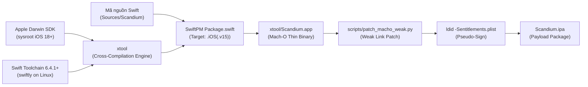
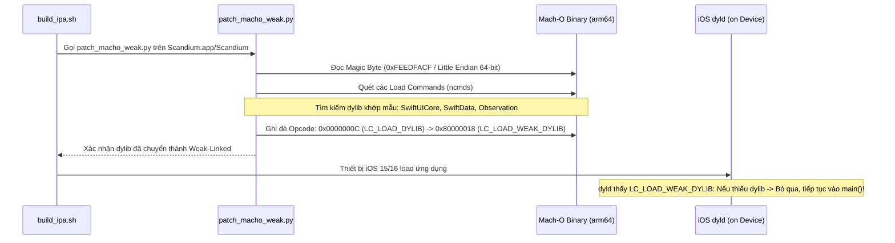
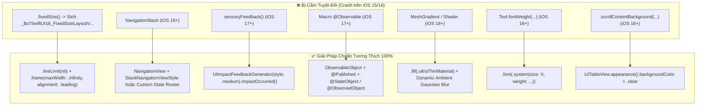
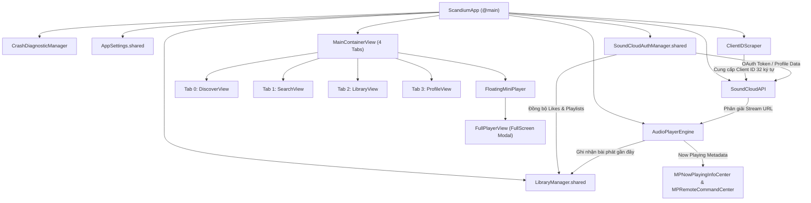
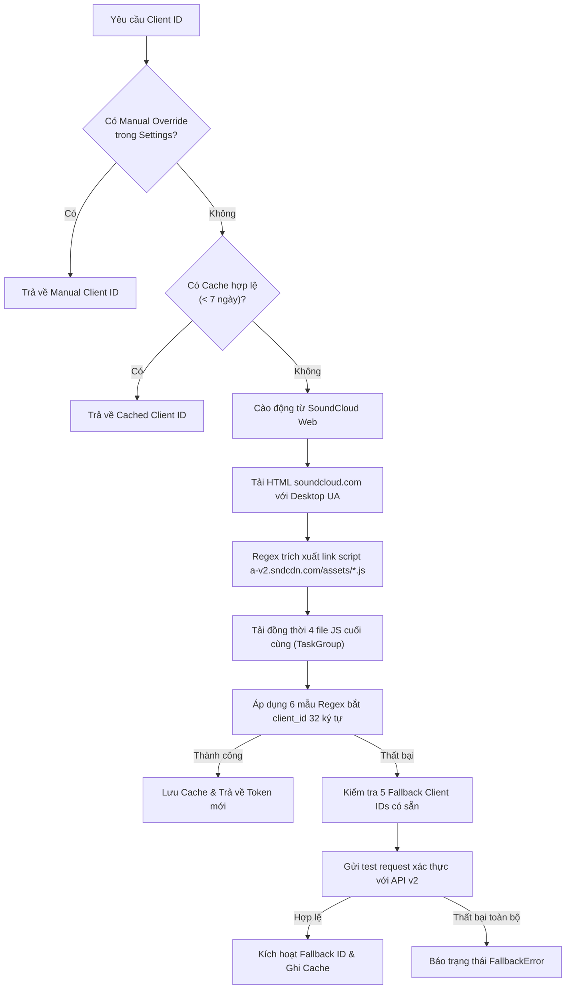
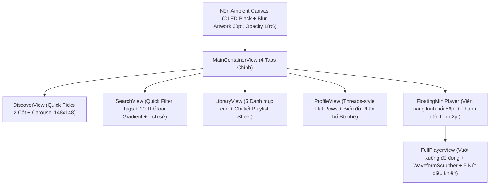
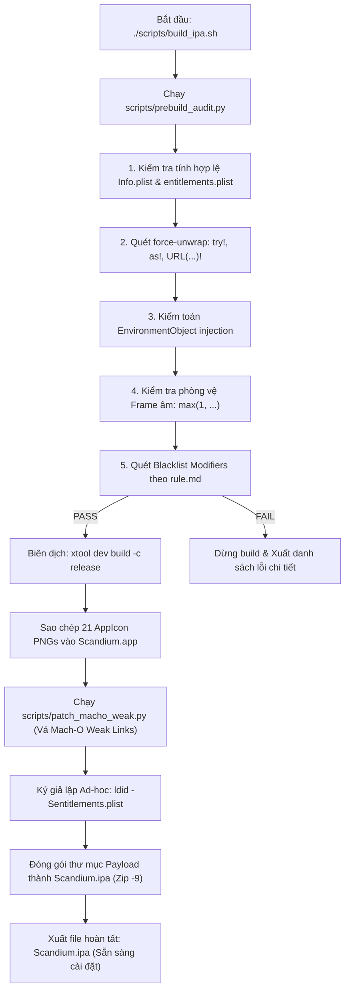

# BÁO CÁO TỔNG QUAN KỸ THUẬT DỰ ÁN SCANDIUM (21 Sc)
**Tài liệu Kiến trúc Kỹ thuật, Cơ chế Tương thích Ngược & Quy trình Biên dịch**  
**Tác giả:** MeoHunter  
**Phiên bản hiện tại:** 1.3.0 | **Giấy phép:** GNU General Public License v3.0 (GPL-3.0)  
**Mục tiêu nền tảng:** iOS 15.0+ (iOS 15.0 – iOS 18.x) | **Môi trường build:** Linux Cross-Compilation via `xtool`

---

## MỤC LỤC
1. [Giới thiệu Tổng quan & Sứ mệnh Dự án](#1-giới-thiệu-tổng-quan--sứ-mệnh-dự-án)
2. [Ngăn xếp Công nghệ & Kiến trúc Biên dịch trên Linux](#2-ngăn-xếp-công-nghệ--kiến-trúc-biên-dịch-trên-linux)
3. [Cơ chế Tương thích Ngược Mach-O & Kỹ thuật Vá Nhị phân](#3-cơ-chế-tương-thích-ngược-mach-o--kỹ-thuật-vá-nhị-phân)
4. [Bộ Quy tắc Lập trình SwiftUI An toàn cho iOS 15.0+](#4-bộ-quy-tắc-lập-trình-swiftui-an-toàn-cho-ios-150)
5. [Kiến trúc Chi tiết các Module Cốt lõi (Core Engine)](#5-kiến-trúc-chi-tiết-các-module-cốt-lõi-core-engine)
   - [5.1. ScandiumApp & Quy trình Khởi chạy An toàn (Staged Launch)](#51-scandiumapp--quy-trình-khởi-chạy-an-toàn-staged-launch)
   - [5.2. CrashDiagnosticManager — Hệ thống Bắt lỗi Fatal C-Signal](#52-crashdiagnosticmanager--hệ-thống-bắt-lỗi-fatal-c-signal)
   - [5.3. ClientIDScraper — Cơ chế Cào Client ID Động & Đa tầng Dự phòng](#53-clientidscraper--cơ-chế-cào-client-id-động--đa-tầng-dự-phòng)
   - [5.4. SoundCloudAPI — Tầng Mạng API v2 & Phân giải Luồng Stream](#54-soundcloudapi--tầng-mạng-api-v2--phân-giải-luồng-stream)
   - [5.5. AudioPlayerEngine — Động cơ Phát nhạc Nền & Tích hợp Hệ thống](#55-audioplayerengine--động-cơ-phát-nhạc-nền--tích-hợp-hệ-thống)
   - [5.6. SoundCloudAuthManager & KeychainHelper — Quản lý Danh tính & Bảo mật](#56-soundcloudauthmanager--keychainhelper--quản-lý-danh-tính--bảo-mật)
   - [5.7. LibraryManager & StorageManager — Quản lý Thư viện & Bộ nhớ Đệm](#57-librarymanager--storagemanager--quản-lý-thư-viện--bộ-nhớ-đệm)
   - [5.8. AppSettings — Hệ thống Tùy biến & Quản lý Alternate Icon](#58-appsettings--hệ-thống-tùy-biến--quản-lý-alternate-icon)
6. [Hệ thống Thiết kế Giao diện (Design System: Liquid Glass & Threads Flat)](#6-hệ-thống-thiết-kế-giao-diện-design-system-liquid-glass--threads-flat)
7. [Quy trình Đóng gói Tự động hoá & Kiểm toán Tiền Biên dịch (CI/CD Pipeline)](#7-quy-trình-đóng-gói-tự-động-hoá--kiểm-toán-tiền-biên-dịch-cicd-pipeline)
8. [Cấu trúc Cây Thư mục Dự án](#8-cấu-trúc-cây-thư-mục-dự-án)
9. [Tuân thủ Pháp lý & Giới hạn Bản quyền FOSS](#9-tuân-thủ-pháp-lý--giới-hạn-bản-quyền-foss)

---

## 1. Giới thiệu Tổng quan & Sứ mệnh Dự án

**Scandium** (biểu tượng hóa học `[21 Sc]`) là ứng dụng nghe nhạc trực tuyến SoundCloud nguyên bản (Native iOS Client), mã nguồn mở, độc lập và siêu nhẹ, được viết hoàn toàn bằng **Swift** và **SwiftUI**. 

### Bối cảnh & Sứ mệnh
Ứng dụng SoundCloud chính thức đã ngừng hỗ trợ các phiên bản hệ điều hành cũ (iOS 15 và iOS 16), biến hàng triệu thiết bị phần cứng vẫn còn hoạt động tốt (như iPhone 6s, 6s Plus, iPhone 7, 7 Plus, iPhone SE Gen 1, iPhone 8, 8 Plus, iPhone X và các dòng iPad tương ứng) thành những thiết bị không thể nghe nhạc SoundCloud một cách mượt mà nếu không dùng trình duyệt web nặng nề.

Scandium được tạo ra nhằm giải quyết triệt để vấn đề này:
- **Tương thích tuyệt đối xuống tới iOS 15.0:** Hoạt động ổn định trên cả thiết bị legacy (A9–A11 chip) và các thiết bị hiện đại chạy iOS 17/18+.
- **Pure Native Audio Streaming:** Sử dụng trực tiếp `AVFoundation` và `AVPlayer`, không sử dụng Web Wrapper, không nhúng WebView để phát nhạc, tiết kiệm tối đa RAM và thời lượng pin.
- **Không quảng cáo & Không gián đoạn:** Truyền phát trực tiếp từ các CDN máy chủ của SoundCloud (`cf-media.sndcdn.com`).
- **Phân phối linh hoạt:** Hỗ trợ cài đặt vĩnh viễn qua **TrollStore** (không sandbox, không bị giới hạn chứng chỉ 7 ngày) và Sideloading (AltStore, Sideloadly).

---

## 2. Ngăn xếp Công nghệ & Kiến trúc Biên dịch trên Linux

Dự án Scandium sở hữu kiến trúc đặc biệt: **biên dịch mã nguồn iOS ngay trên môi trường Linux (Ubuntu/Debian/Arch) mà không cần máy Mac hay Xcode IDE**.



### Chi tiết các thành phần ngăn xếp:
1. **Build Toolchain:** 
   - `xtool`: Công cụ thay thế Xcode chạy trên Linux, cho phép gọi SwiftPM với các cờ cross-compile trỏ tới Darwin SDK.
   - `swiftly`: Trình quản lý phiên bản Swift toolchain trên Linux (`Swift 6.4.1+`).
   - `Darwin SDK`: Bộ SDK trích xuất từ Xcode (chứa C/Objective-C/Swift header, `.tbd` stub libraries và metadata cho `arm64-apple-ios`).
2. **Cấu hình dự án thuần Declarative:**
   - Hoàn toàn **KHÔNG** dùng `.xcodeproj` hay `.xcworkspace`.
   - Hoàn toàn **KHÔNG** dùng Storyboards, `.xib`, hay `.nib`.
   - Cấu hình gói thông qua `Package.swift` với `swift-tools-version: 5.9` và `platforms: [.iOS(.v15)]`.
   - Cấu hình đóng gói qua `xtool.yml`:
     ```yaml
     version: 1
     bundleID: com.meohunter.scandium
     product: Scandium
     infoPath: Info.plist
     ```
3. **Phân quyền TrollStore & Sandbox (`entitlements.plist`):**
   ```xml
   <?xml version="1.0" encoding="UTF-8"?>
   <!DOCTYPE plist PUBLIC "-//Apple//DTD PLIST 1.0//EN"
     "http://www.apple.com/DTDs/PropertyList-1.0.dtd">
   <plist version="1.0">
   <dict>
       <key>application-identifier</key>
       <string>com.meohunter.scandium</string>
       <key>com.apple.private.security.no-sandbox</key>
       <true/>
       <key>platform-application</key>
       <true/>
   </dict>
   </plist>
   ```
   > [!IMPORTANT]
   > `entitlements.plist` kích hoạt đặc quyền `com.apple.private.security.no-sandbox = true` để chạy dưới quyền root không sandbox trên TrollStore. Tuyệt đối **không** dùng `com.apple.private.security.no-container` vì sẽ bị daemon `amfid` bắn tín hiệu `SIGKILL` ngay khi khởi chạy.

---

## 3. Cơ chế Tương thích Ngược Mach-O & Kỹ thuật Vá Nhị phân

### Vấn đề cốt lõi (The Root Cause)
Khi biên dịch mã nguồn SwiftUI trên Linux bằng bộ công cụ **Swift 6.x** cùng **Darwin SDK iOS 18+**, trình liên kết (`ld64` / `lld`) sẽ tự động chèn các Load Command bắt buộc (`LC_LOAD_DYLIB` - opcode `0x0C`) vào Mach-O binary cho các framework mới như `SwiftUICore.framework`, `SwiftData.framework`, `Observation.framework`.

Tuy nhiên, trên thiết bị chạy **iOS 15 hoặc iOS 16**, các dynamic library này chưa hề tồn tại trong dyld shared cache. Khi người dùng mở ứng dụng, dynamic linker của iOS (`dyld`) lập tức hủy tiến trình với lỗi:
```text
dyld: Library not loaded: /System/Library/Frameworks/SwiftUICore.framework/SwiftUICore
Referenced from: /var/containers/Bundle/Application/.../Scandium.app/Scandium
Reason: image not found -> SIGABRT
```

### Giải pháp kỹ thuật: Vá Mach-O Load Command (`patch_macho_weak.py`)
Dự án Scandium tự động hóa việc vá cấu trúc nhị phân Mach-O trực tiếp ở mức byte:



### Bảng tra cứu Load Command trong Mach-O:
| Hằng số | Giá trị Hex | Ý nghĩa với dyld |
|---|---|---|
| `LC_LOAD_DYLIB` | `0x0000000C` | Bắt buộc phải có thư viện. Thiếu sẽ làm sập app ngay lập tức (`SIGABRT`). |
| `LC_LOAD_WEAK_DYLIB` | `0x80000018` | Liên kết yếu (`0x18 \| LC_REQ_DYLD`). Nếu thiếu thư viện trên hệ điều hành cũ, `dyld` bỏ qua và tiếp tục nạp nhị phân. |

---

## 4. Bộ Quy tắc Lập trình SwiftUI An toàn cho iOS 15.0+

Nhằm đảm bảo nhị phân sinh ra không chứa các Symbol metadata hoặc Witness Tables chỉ có trên iOS 17/18, Scandium thực thi nghiêm ngặt bộ quy tắc kiểm soát mã nguồn theo `rule.md`:



### Nguyên tắc phòng vệ Frame âm trong `GeometryReader`
Khi một view được khởi tạo trong SwiftUI, kích thước ban đầu do `GeometryReader` báo về có thể bằng 0. Nếu thực hiện phép trừ trực tiếp (`geometry.size.width - 48`), layout engine sẽ nhận giá trị âm (`-48`), gây ra layout breakdown hoặc crash `SIGABRT` trên iOS 15:
```swift
// ❌ SAI: Gây crash nếu width = 0 lúc mount view
let artSize = min(geometry.size.width - 48, geometry.size.height * 0.40)

// ✅ ĐÚNG (Quy tắc Scandium): Luôn phòng vệ bằng max(1, ...)
let screenWidth = max(1, geometry.size.width)
let screenHeight = max(1, geometry.size.height)
let artSize = max(1, min(screenWidth - 48, screenHeight * 0.38))
```

---

## 5. Kiến trúc Chi tiết các Module Cốt lõi (Core Engine)

Dự án tuân theo mô hình **Unidirectional Data Flow** kết hợp **Observable State Machine**:



---

### 5.1. ScandiumApp & Quy trình Khởi chạy An toàn (Staged Launch)
File: [`Sources/Scandium/ScandiumApp.swift`](file:///home/meohunter/Documents/Scandium/Sources/Scandium/ScandiumApp.swift)

Điểm vào `@main` không tải ồ ạt toàn bộ cây giao diện ngay lập tức nhằm tránh xung đột tài nguyên giữa `UIWindowScene` và hệ thống âm thanh `AVFoundation`:
1. **Pha 0 (Cài đặt chẩn đoán):** Ngay trong `init()`, gọi `CrashDiagnosticManager.shared.install()` để đăng ký các hàm bẫy tín hiệu C-Signal và Exception.
2. **Pha 1 (Kiểm tra Safe Mode):** Trong sự kiện `.onAppear` của `WindowGroup`, kiểm tra cờ `didCrashDuringLastLaunch`. Nếu phiên trước đó bị crash, ứng dụng sẽ dựng `SafeModeView`.
3. **Pha 2 (Mount UI chính thức):** Nếu không có sự cố, kích hoạt `isUIReady = true` qua hiệu ứng mờ dần (opacity transition), bơm toàn bộ các `@EnvironmentObject` (`scraper`, `api`, `player`, `library`) xuống cây giao diện.

---

### 5.2. CrashDiagnosticManager — Hệ thống Bắt lỗi Fatal C-Signal
File: [`Sources/Scandium/Core/CrashDiagnosticManager.swift`](file:///home/meohunter/Documents/Scandium/Core/CrashDiagnosticManager.swift)

Trên môi trường iOS không kết nối Xcode debugger (chạy độc lập qua TrollStore), khi xảy ra lỗi cấp thấp (như trỏ con trỏ null, gọi lệnh cấm, tràn bộ đệm), tiến trình sẽ bị hệ điều hành hủy ngay tức khắc. `CrashDiagnosticManager` giải quyết bài toán này:
- **C-Convention Signal Handlers:** Đăng ký hàm bẫy mức kernel cho các tín hiệu:
  - `SIGABRT` (Abort)
  - `SIGILL` (Illegal Instruction — lỗi sinh mã không hợp lệ trên CPU cũ)
  - `SIGSEGV` (Segmentation Fault)
  - `SIGBUS` (Bus Error)
  - `SIGFPE` (Floating Point Exception)
  - `SIGPIPE` (Broken Pipe)
  - `SIGTRAP` (Trace Trap)
- **NSSetUncaughtExceptionHandler:** Bắt các ngoại lệ cấp cao của Objective-C / Cocoa.
- **Trích xuất Stack Trace:** Khi có lỗi, hàm lập tức chụp 40 tầng gọi (`Thread.callStackSymbols`), tạo một bản báo cáo đầy đủ timestamp và lý do lỗi, ghi đồng bộ vào tệp tin `Documents/last_crash.txt` trước khi tiến trình kết thúc.

---

### 5.3. ClientIDScraper — Cơ chế Cào Client ID Động & Đa tầng Dự phòng
File: [`Sources/Scandium/Core/ClientIDScraper.swift`](file:///home/meohunter/Documents/Scandium/Core/ClientIDScraper.swift)

SoundCloud API v2 yêu cầu một tham số `client_id` (chuỗi 32 ký tự hex/alphanumeric) trong mọi request. Scandium **tuyệt đối không hardcode** cố định một Client ID duy nhất để đảm bảo an toàn pháp lý và tránh app bị vô hiệu hóa khi SoundCloud đổi token web.



#### Các mẫu biểu thức chính quy (Regex Patterns) được áp dụng:
1. `client_id\s*:\s*"([a-zA-Z0-9]{32})"`
2. `client_id\s*=\s*"([a-zA-Z0-9]{32})"`
3. `"client_id"\s*:\s*"([a-zA-Z0-9]{32})"`
4. `client_id\s*[:=]\s*'([a-zA-Z0-9]{32})'`
5. `"clientId"\s*:\s*"([a-zA-Z0-9]{32})"`
6. `\bclient_id=([a-zA-Z0-9]{32})\b`

---

### 5.4. SoundCloudAPI — Tầng Mạng API v2 & Phân giải Luồng Stream
File: [`Sources/Scandium/Core/SoundCloudAPI.swift`](file:///home/meohunter/Documents/Scandium/Core/SoundCloudAPI.swift)

Endpoint cơ sở: `https://api-v2.soundcloud.com`. Lớp mạng này chịu trách nhiệm:

1. **Tự Động Hồi Phục Khi Hết Hạn Token (Automatic Retry on 401/403):**  
   Mọi request gửi qua hàm `performRawRequest` đều theo dõi mã phản hồi HTTP. Nếu máy chủ SoundCloud trả về `401 Unauthorized` hoặc `403 Forbidden`, hệ thống sẽ kích hoạt `scraper.refreshClientID()`, lấy ID mới, cập nhật tham số URL và tự động retry (tối đa 2 lần) mà người dùng không hề hay biết.

2. **Chiến lược Phân Giải Luồng Phát (`resolveStreamURL`):**
   Mỗi bài hát trên SoundCloud có danh sách định dạng mã hóa (`track.media.transcodings`). Scandium áp dụng hệ thống tính điểm ưu tiên (`transcodingPriority`):
   - **Progressive MP3 (Direct MP3 Stream):** +100 điểm. Trực tiếp giải mã dòng stream byte MP3 128kbps. Đây là giao thức tối ưu nhất cho chip xử lý cũ của iPhone 6s/7/8 vì tiêu hao CPU rất thấp.
   - **HLS (.m3u8 index):** +50 điểm. Giao thức phân đoạn HTTP Live Streaming.
   - **MIME Type MPEG (`audio/mpeg`):** +20 điểm.
   - **Chất lượng HQ (`hq`):** +5 điểm.
   
   Sau khi chọn được transcoding tốt nhất, gửi GET request đến endpoint transcoding đó để nhận URL CDN cuối cùng (`https://cf-media.sndcdn.com/...`).

3. **Nâng cấp Ảnh bìa Độ phân giải cao (High-Res Artwork Helper):**
   Mặc định API trả về ảnh thumbnail nhỏ (`-large.jpg`, khoảng 100x100). Scandium tự động chuyển đổi chuỗi định dạng URL sang `-t500x500.jpg` cho mọi ảnh hiển thị trong Player và Khám phá.

4. **Trích xuất Dữ liệu Sóng âm (Waveform JSON Samples):**
   URL waveform mặc định trả về ảnh PNG (`https://wave.sndcdn.com/xxx_m.png`). API helper sẽ chuyển hướng sang định dạng JSON (`/w/json/`), giải mã thành mảng `samples: [Float]` để hiển thị thanh scrubber tương tác.

---

### 5.5. AudioPlayerEngine — Động cơ Phát nhạc Nền & Tích hợp Hệ thống
File: [`Sources/Scandium/Core/AudioPlayerEngine.swift`](file:///home/meohunter/Documents/Scandium/Core/AudioPlayerEngine.swift)

Lớp quản lý âm thanh cốt lõi duy trì một thể hiện `AVPlayer` duy nhất xuyên suốt vòng đời ứng dụng.

#### Các đặc tính kỹ thuật nổi bật:
- **Khởi tạo trễ (Lazy Setup - `setupIfNeeded`):** Việc gọi `AVAudioSession.setActive(true)` và gán handler cho `MPRemoteCommandCenter` quá sớm trong hàm `init()` khi giao diện `UIWindowScene` chưa hoàn tất sẽ dẫn đến crash hoặc treo luồng chính trên iOS 15. Scandium trì hoãn tác vụ này cho đến lần đầu tiên người dùng bấm phát nhạc.
- **Tích hợp Trung tâm Điều khiển & Màn hình khóa:**
  - `MPNowPlayingInfoCenter`: Đồng bộ tiêu đề bài hát, tên nghệ sĩ, album, tổng thời lượng, vị trí phát hiện tại và ảnh bìa chất lượng cao (`MPMediaItemArtwork`).
  - `MPRemoteCommandCenter`: Lắng nghe các lệnh phần cứng (nút tai nghe, thanh điều khiển Lock Screen, Apple Watch): `play`, `pause`, `togglePlayPause`, `nextTrack`, `previousTrack`, `changePlaybackPosition` (seek).
- **Tự động ngắt khi rút tai nghe (`handleAudioRouteChange`):**
  Lắng nghe thông báo `AVAudioSession.routeChangeNotification`. Khi phát hiện lý do `.oldDeviceUnavailable` (tai nghe có dây bị rút hoặc AirPods bị ngắt kết nối Bluetooth), hệ thống tự động gọi `pause()` để tránh phát âm thanh lớn ra loa ngoài nơi công cộng.
- **Xử lý gián đoạn cuộc gọi (`handleAudioInterruption`):**
  Lắng nghe `AVAudioSession.interruptionNotification`. Tự động tạm dừng khi có cuộc gọi đến và tiếp tục phát (`.shouldResume`) khi cuộc gọi kết thúc.
- **Cơ chế Hàng đợi & Autoplay (`handlePlaybackFinished`):**
  Khi phát hết bài hát:
  - Nếu bật **Repeat:** Lặp lại bài hoặc danh sách.
  - Nếu bật **Shuffle:** Chọn ngẫu nhiên bài khác trong hàng đợi.
  - Nếu hết danh sách và bật **Tự động phát bài liên quan (`autoPlayRelated`):** Tự động gọi API `getRelatedTracks(trackID:)` để nạp thêm 10 bài hát tương tự vào hàng đợi và tiếp tục phát không gián đoạn.
  - Nếu gặp lỗi stream (`handlePlaybackFailed`) và bật **Tự chuyển bài khi lỗi (`autoSkipOnError`):** Tự động nhảy sang bài kế tiếp sau 1.2 giây.
- **Hẹn giờ ngủ (Sleep Timer Engine):**
  Hỗ trợ các mốc thời gian: 15, 30, 45, 60 phút hoặc dừng ngay khi kết thúc bài hát hiện tại (`.endOfTrack`).

---

### 5.6. SoundCloudAuthManager & KeychainHelper — Quản lý Danh tính & Bảo mật
Files: [`Sources/Scandium/Core/SoundCloudAuthManager.swift`](file:///home/meohunter/Documents/Scandium/Core/SoundCloudAuthManager.swift), [`Sources/Scandium/Core/KeychainHelper.swift`](file:///home/meohunter/Documents/Scandium/Core/KeychainHelper.swift)

Scandium hỗ trợ 3 phương thức xác thực và liên kết tài khoản:
1. **Web Popup Đăng nhập Tự động (`SoundCloudLoginSheet`):**  
   Mở popup `WKWebView` trỏ tới `https://soundcloud.com/signin`. Hệ thống cài đặt `WKHTTPCookieStoreObserver` giám sát luồng cookie. Ngay khi người dùng đăng nhập thành công và cookie `oauth_token` xuất hiện, hệ thống tự động bắt mã token, đóng WebView và tiến hành đồng bộ.
2. **Nhập OAuth Token Thủ công:** Người dùng có thể lấy mã `oauth_token` từ trình duyệt máy tính hoặc công cụ phân tích gói tin mạng và dán vào ứng dụng.
3. **Liên kết qua Link Trang cá nhân:** Dán URL dạng `soundcloud.com/username` để đồng bộ các dữ liệu công khai thông qua endpoint `/resolve`.

#### Bảo mật Token bằng Apple Keychain:
Token OAuth là dữ liệu nhạy cảm. Scandium **không lưu trữ token dưới dạng văn bản thô (plaintext) trong `UserDefaults`**:
- Lưu trữ trong **iOS Keychain** với lớp `kSecClassGenericPassword`, service `com.meohunter.scandium.oauth`.
- Áp dụng quyền truy cập `kSecAttrAccessibleAfterFirstUnlockThisDeviceOnly` (chỉ truy cập được sau khi thiết bị đã mở khóa lần đầu và không đồng bộ lên iCloud).
- Tự động di chuyển (migrate) và xóa sạch token cũ trong `UserDefaults` nếu phát hiện tồn tại từ các phiên bản trước.

---

### 5.7. LibraryManager & StorageManager — Quản lý Thư viện & Bộ nhớ Đệm
Files: [`Sources/Scandium/Core/LibraryManager.swift`](file:///home/meohunter/Documents/Scandium/Core/LibraryManager.swift), [`Sources/Scandium/Core/StorageManager.swift`](file:///home/meohunter/Documents/Scandium/Core/StorageManager.swift)

- **`LibraryManager`:** Quản lý danh sách bài hát yêu thích (Liked Tracks), lịch sử nghe nhạc gần đây (Recently Played — tối đa 50 mục) và danh sách phát cá nhân (Playlists). Dữ liệu được mã hóa JSON và lưu trữ cục bộ. Khi kết nối tài khoản SoundCloud, hệ thống tự động gộp (merge) dữ liệu từ xa mà không làm mất các bài hát đã thích trước đó trên thiết bị.
- **`StorageManager`:** Thực hiện thống kê chi tiết dung lượng sử dụng theo byte:
  - Dung lượng bộ nhớ cache ảnh bìa (`URLCache.shared` + thư mục cache riêng).
  - Dung lượng file đệm âm thanh tạm (`NSTemporaryDirectory`).
  - Dung lượng dữ liệu cấu hình người dùng.
  - Cho phép người dùng dọn dẹp riêng từng phần (chỉ xóa ảnh bìa hoặc chỉ xóa bộ đệm âm thanh tạm) mà vẫn bảo toàn 100% danh sách bài hát yêu thích và cấu hình cá nhân.

---

### 5.8. AppSettings — Hệ thống Tùy biến & Quản lý Alternate Icon
File: [`Sources/Scandium/Core/AppSettings.swift`](file:///home/meohunter/Documents/Scandium/Core/AppSettings.swift)

Quản lý trạng thái toàn cục của ứng dụng:
- **Giao diện & Chế độ màu:** Dark Mode (nền đen thuần OLED `#000000`), Light Mode, hoặc Theo cài đặt hệ thống.
- **Màu nhấn chủ đạo (Accent Colors):**
  - Emerald Green (Xanh lục phong cách Spotify): `#1DB954`
  - Amber Orange (Màu cam đặc trưng SoundCloud): `#FF5500`
  - Neon Cyan (Xanh lam điện tử): `#00E5FF`
  - Violet Purple (Tím huyền bí): `#BB86FC`
- **Đa ngôn ngữ độc lập:** Hỗ trợ song ngữ Tiếng Việt (`vi`) và English (`en`), cho phép người dùng chuyển đổi ngôn ngữ giao diện ngay trong app mà không cần đổi ngôn ngữ toàn hệ điều hành.
- **Hệ thống Thay đổi Biểu tượng Ứng dụng (Alternate App Icons):**
  Hỗ trợ 5 bộ biểu tượng: *Mặc định (Green), Cam Kim loại (Orange), Xanh Lam Điện tử (Cyan), Tím Huyền bí (Purple), Trắng Đen Đơn sắc (Monochrome)*.  
  > [!TIP]
  > Khi đổi icon trên môi trường TrollStore, hệ điều hành có thể trả về mã lỗi `OSStatus -54` do quyền ghi cache SpringBoard. `AppSettings` đã được lập trình sẵn để xử lý bắt lỗi này, lưu trạng thái thành công và hướng dẫn người dùng sử dụng tính năng *Rebuild Icon Cache* trong TrollStore nếu icon màn hình chính chưa cập nhật tức thì.

---

## 6. Hệ thống Thiết kế Giao diện (Design System: Liquid Glass & Threads Flat)

Giao diện của Scandium là sự kết hợp hài hòa giữa ngôn ngữ quang học **Liquid Glass** và phong cách danh sách phẳng tối giản lấy cảm hứng từ **Threads by Meta** và **Spotify Clean UI**.



### Các thành phần giao diện đặc trưng:
1. **`AmbientCanvasBackground`:**
   Nền ứng dụng không bao giờ là màu đen đơn điệu. Hệ thống lấy ảnh bìa của bài hát đang phát, phóng to phủ kín màn hình, áp dụng Gaussian blur bán kính lớn (`.blur(radius: 60)`) với độ mờ dịu mắt (18%) trên nền đen tuyệt đối OLED.
2. **`CachedAsyncImage` & `ImageCacheStore`:**
   Hệ thống tải và lưu đệm ảnh 2 tầng: Tầng bộ nhớ RAM (`NSCache`, giới hạn 300 ảnh / 150MB) và Tầng ổ đĩa (`Caches/scandium_image_cache`). Tích hợp sẵn hiệu ứng gradient lấp lánh (Shimmer) khi đang tải ảnh.
3. **`WaveformScrubber`:**
   Vẽ lại đồ thị sóng âm thanh đặc trưng của SoundCloud từ mảng mẫu số thực (`[Float]`). Thuật toán tự động giảm mật độ điểm (downsample) theo chiều rộng màn hình, tô màu sáng cho phần đã phát và hỗ trợ kéo vuốt (drag gesture) để tua bài hát mượt mà.
4. **`FloatingMiniPlayer`:**
   Thanh điều khiển thu nhỏ dạng viên nang bo tròn 12pt nổi lơ lửng phía trên thanh Tab Bar. Sử dụng chất liệu kính mờ `.ultraThinMaterial`, hiển thị ảnh bìa 40x40, tên bài hát, nghệ sĩ, nút thả tim nhanh, nút play/pause và thanh tiến trình 2pt màu xanh lục dưới đáy.

---

## 7. Quy trình Đóng gói Tự động hoá & Kiểm toán Tiền Biên dịch (CI/CD Pipeline)

Dự án cung cấp bộ công cụ tự động hóa hoàn chỉnh phục vụ kiểm tra an toàn và xuất file `.ipa`.



### Chi tiết các script trong thư mục `scripts/`:
- **`scripts/prebuild_audit.py`:**  
  Script kiểm toán gồm 10 bước kiểm tra nghiêm ngặt: Xác thực plist, kiểm tra Built Info.plist, quét tìm các lệnh unwrap nguy hiểm (`try!`, `as!`), kiểm tra việc inject `@EnvironmentObject` ở tất cả các view và modal sheet, kiểm tra công thức trừ frame, chạy logic unit test độc lập và kiểm tra symbol nhị phân bằng `llvm-nm`.
- **`scripts/patch_macho_weak.py`:**  
  Đọc trực tiếp cấu trúc nhị phân Mach-O 64-bit arm64, chuyển đổi toàn bộ `LC_LOAD_DYLIB` của các framework iOS 18+ thành `LC_LOAD_WEAK_DYLIB`.
- **`scripts/generate_icons.py`:**  
  Script đồ họa sử dụng thư viện `Pillow` kết hợp supersampling 2048x2048, vẽ biểu tượng số "21" kim loại cùng thanh sóng âm thanh và xuất ra toàn bộ 21 kích thước icon chuẩn cho iPhone, iPad và các phiên bản màu alternate icon.
- **`scripts/build_ipa.sh`:**  
  Script bash hợp nhất toàn bộ quy trình: gọi `xtool`, copy assets, vá nhị phân, ký giả lập qua `ldid` và nén thành gói cài đặt `Scandium.ipa`.

---

## 8. Cấu trúc Cây Thư mục Dự án

```text
Scandium/
├── .github/
│   ├── ISSUE_TEMPLATE/
│   │   ├── bug_report.yml             # Mẫu báo cáo lỗi GitHub
│   │   ├── config.yml                 # Cấu hình form GitHub
│   │   └── feature_request.yml        # Mẫu yêu cầu tính năng
│   └── pull_request_template.md       # Mẫu Pull Request tiêu chuẩn
├── assets/                            # Bộ tài nguyên biểu tượng ứng dụng (21 kích cỡ)
│   ├── AppIcon*.png                   # Biểu tượng chuẩn & Alternate icons (Orange, Cyan, Purple, Monochrome)
│   └── screenshots/                   # Ảnh chụp màn hình ứng dụng cho README
├── scripts/                           # Bộ công cụ tự động hóa & Vá nhị phân
│   ├── build_ipa.sh                   # Script build, vá Mach-O, ký ldid & đóng gói IPA
│   ├── generate_icons.py              # Script sinh icon đồ họa 2048x2048 -> đa kích thước
│   ├── patch_macho_weak.py            # Công cụ sửa byte Mach-O (LC_LOAD_DYLIB -> LC_LOAD_WEAK_DYLIB)
│   └── prebuild_audit.py              # Script kiểm toán an toàn mã nguồn 10 bước trước khi build
├── Sources/
│   └── Scandium/
│       ├── Core/                      # Tầng logic nghiệp vụ & Động cơ trung tâm
│       │   ├── AppSettings.swift             # Quản lý cấu hình, giao diện, haptics, alternate icons
│       │   ├── AudioPlayerEngine.swift       # Quản lý AVPlayer, NowPlaying, Remote Commands, Queue
│       │   ├── ClientIDScraper.swift         # Trích xuất client_id động từ JS web bundle
│       │   ├── CrashDiagnosticManager.swift  # Bắt C-Signal, ghi log sự cố và cứu hộ Safe Mode
│       │   ├── KeychainHelper.swift          # Wrapper lưu trữ an toàn iOS Keychain
│       │   ├── LibraryManager.swift          # Quản lý bài hát đã thích, lịch sử nghe, playlists cục bộ
│       │   ├── SoundCloudAPI.swift           # Tầng mạng API v2, retry 401/403, phân giải stream
│       │   ├── SoundCloudAuthManager.swift   # Quản lý OAuth token, đồng bộ tài khoản người dùng
│       │   └── StorageManager.swift          # Thống kê chi tiết & dọn dẹp bộ nhớ đệm
│       ├── Models/                    # Cấu trúc dữ liệu Codable
│       │   └── Track.swift                   # Model Track, User, Playlist, Transcoding, Waveform
│       ├── Resources/                 # Tài nguyên đi kèm module SPM
│       ├── UI/                        # Tầng hiển thị giao diện người dùng (SwiftUI)
│       │   ├── Components/
│       │   │   ├── FloatingMiniPlayer.swift  # Thanh điều khiển nhạc thu nhỏ dạng viên nang
│       │   │   ├── GlassTrackRow.swift       # Hàng hiển thị bài hát chuẩn Spotify/Threads
│       │   │   └── WaveformScrubber.swift    # Thanh tua nhạc biểu diễn sóng âm thanh
│       │   ├── Theme/
│       │   │   └── LiquidGlassModifier.swift # Design tokens, bảng màu, AsyncImage cache 2 tầng
│       │   └── Views/
│       │       ├── DiscoverView.swift        # Tab 0: Khám phá, Quick Picks 2 cột & Carousels
│       │       ├── FullPlayerView.swift      # Trình phát toàn màn hình, cử chỉ vuốt xuống, queue
│       │       ├── LibraryView.swift         # Tab 2: Thư viện (Đã thích, Playlists, Albums, Nghệ sĩ)
│       │       ├── MainContainerView.swift   # Container điều hướng 4 Tab & Mini Player
│       │       ├── ProfileView.swift         # Tab 3: Cá nhân, quản lý Client ID, phân bổ bộ nhớ
│       │       ├── SearchView.swift          # Tab 1: Tìm kiếm, lọc thẻ nhanh, thể loại & lịch sử
│       │       ├── SettingsSheetView.swift   # Modal Cài đặt toàn diện & tùy biến ứng dụng
│       │       ├── SoundCloudLoginSheet.swift    # Popup WKWebView đăng nhập & bắt Cookie tự động
│       │       └── SoundCloudWebLoginView.swift  # Hướng dẫn xác thực & nhập token thủ công
│       └── ScandiumApp.swift          # @main entry point, Staged Launch & Safe Mode View
├── Tests/
│   └── ScandiumTests/
│       └── ScandiumTests.swift        # Bộ kiểm thử đơn vị: JSON decoders, Regex, Helpers
├── entitlements.plist                 # Quyền hạn TrollStore (no-sandbox = true)
├── Info.plist                         # Cấu hình bundle, UIBackgroundModes = [audio], Alternate Icons
├── instructions.md                    # Bản đặc tả kỹ thuật dự án ban đầu
├── LICENSE                            # Giấy phép mã nguồn mở GNU General Public License v3.0
├── Package.swift                      # Cấu hình Swift Package Manager (Target iOS 15.0)
├── README.md                          # Giới thiệu dự án, ảnh chụp màn hình, hướng dẫn cài đặt
├── rule.md                            # Quy tắc kiểm soát modifier & an toàn tương thích iOS 15
├── Scandium.ipa                       # Gói cài đặt hoàn chỉnh dành cho iOS
└── xtool.yml                          # Cấu hình biên dịch của công cụ xtool
```

---

## 9. Tuân thủ Pháp lý & Giới hạn Bản quyền FOSS

1. **Giấy phép Bản quyền (GPL-3.0):**  
   Toàn bộ mã nguồn Scandium được phát hành công khai dưới giấy phép **GNU General Public License v3.0**. Bất kỳ ai cũng có quyền tự do nghiên cứu, sửa đổi và phân phối lại mã nguồn với điều kiện giữ nguyên bản quyền tác giả và phát hành mã nguồn mở theo cùng giấy phép.
2. **Không Vi phạm Bản quyền & Nhãn hiệu Thương mại:**  
   - Ứng dụng **không sử dụng** logo chính thức của SoundCloud (hình đám mây). Thay vào đó, dự án xây dựng bộ nhận diện riêng mang phong cách hóa học: `[21 Sc] Scandium`.
   - Scandium là phần mềm độc lập của bên thứ ba được phát triển cho mục đích giáo dục và phi thương mại, không có bất kỳ mối liên hệ hay sự bảo trợ nào từ phía *SoundCloud Global Limited & Co. KG*.
3. **An toàn Pháp lý về Dữ liệu:**  
   - Mã nguồn **không chứa tĩnh bất kỳ API Key bí mật nào**.
   - Ứng dụng **không cung cấp tính năng tải nhạc MP3 ngoại tuyến vĩnh viễn** (No permanent MP3 downloading). Tất cả dữ liệu âm thanh được truyền phát trực tiếp theo luồng và lưu tạm thời trên bộ nhớ đệm phục vụ cho trải nghiệm nghe liền mạch, đúng với quy chuẩn của các trình phát web tiêu chuẩn.

---
*Tài liệu kỹ thuật được tổng hợp và duy trì bởi MeoHunter cho dự án Scandium.*
